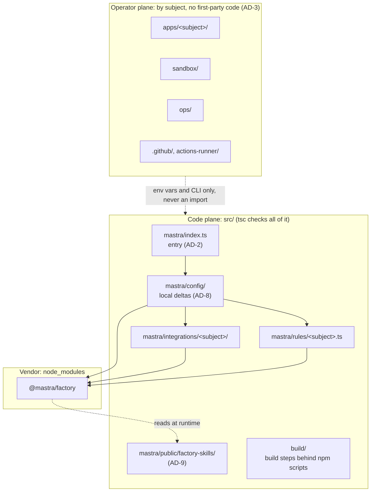
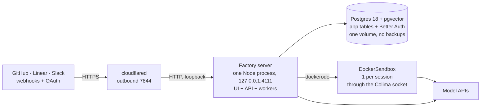

# Architecture decisions

This document records the goals, the constraints and the architecture decisions of this deployment.
The decisions have stable IDs, AD-1 to AD-13. Other documents cite them by ID, so do not renumber them.

The text came from the BMAD planning records of 2026-09-22 (the spec and the architecture spine).
It is updated to the repository on 2026-10-18. When this document and the code do not agree, the
code is correct. Operational detail is in [self-hosting-research.md](self-hosting-research.md),
§2–§11, and the CI/CD design is in [ci-deploy-research.md](ci-deploy-research.md).

## Goal

Run Mastra Factory 24/7 on one Mac at `https://factory.kovalchuk.win`, with no dependency on
Mastra's platform. The deployment owns its GitHub, Linear and Slack apps, its identity provider,
its sandboxes and its Postgres.

"Self-hosted" is a property that the configuration must hold. It is not the default. Some
environment keys silently move identity or sandboxes back to Mastra's platform, with only a
warning. AGENTS.md lists those keys.

### Capabilities

| ID | Capability | Proof that it works |
| --- | --- | --- |
| CAP-1 | Docker sandboxes on this machine | A session gets one container from a tagged image. `git` and `gh` work in it. A session past the admission limit gets a clear error. No repository is cloned onto the host. |
| CAP-2 | Self-hosted identity with organizations | `/signin` uses email and password against this Postgres. A first login has an organization. After registration closes, `POST /auth/api/sign-up/email` is refused. |
| CAP-3 | Own GitHub App | A webhook delivery reaches `/web/github/webhook`, and an issue becomes a merged pull request. |
| CAP-4 | Own Linear app | An issue from Linear becomes a work item. Linear @-mentions are not possible at this package version; see [apps/linear/README.md](../apps/linear/README.md). |
| CAP-5 | Own Slack app | `apps/slack/manifest.yaml` creates a working app. A test delivery reaches the channels webhook. Account linking completes over OIDC. |
| CAP-6 | Public ingress with no inbound ports | Sign-in works over HTTPS at the public origin. The server binds only `127.0.0.1:4111`, and only outbound port `7844` is in use. |
| CAP-7 | Unattended 24/7 supervision | The deployment survives `launchctl kickstart -k` and a logout and login. The server waits for the Docker socket. Logs rotate. |
| CAP-8 | Operational artifacts are real files | Each artifact is one real file at its own path. Each operator-plane directory has a README. |
| CAP-9 | A minimal entry with recorded provenance | `src/mastra/index.ts` holds only the four things of AD-8. `src/mastra/config/README.md` records the template origin. |
| CAP-10 | One datastore, no Redis | The server starts without `REDIS_URL`, and `docker-compose.yml` has no `redis` service. Auth tables and app tables use one database. |

The final proof: one issue from GitHub, one from Linear and one from a Slack mention each become a
merged pull request. Each one runs in a Docker container on this machine, with credentials that
the operator owns. Then a logout and a login occur, and the deployment serves again with no
command typed.

## Design paradigm: two planes, one subject vocabulary

The deployment is one npm package and one Node process. Each file in the repository belongs to one
of two planes:

- **Operator plane.** A person or an external system uses these files: a provider console,
  `docker build`, `launchd`, `newsyslog`, GitHub Actions. They are grouped by subject (`apps/github/`,
  `apps/slack/`, `sandbox/`, `ops/`). They contain no first-party TypeScript.
- **Code plane.** All files under `src/`. The reach of the TypeScript compiler sets this boundary.
  The directories use the same subject names as the operator plane.

The operator plane reaches the code plane only through environment variables and CLI commands. It
never imports code.

## Decisions

### AD-1: One npm package, no workspaces

The repository has one `package.json` and one `package-lock.json`, both at the root. The package
manager is npm. Do not add a `workspaces` field or a pnpm or yarn workspace file.

Reason: a split creates empty packages and resolves every dependency again, on a machine with no
backups.

### AD-2: The entry file cannot be divided

`src/mastra/index.ts` must export a `Mastra` instance named `mastra`. A literal `new Mastra(...)` in
that file must construct it. The `checkConfigExport` Babel plugin of the deployer reads the source
of the entry. Do not re-export the instance from another module, and do not construct it in a
helper.

Reason: a change of this kind breaks `mastra build`, and only a deploy shows the failure.

### AD-3: Two planes, one subject vocabulary

Each new file belongs to one plane, except the trees in AD-13. Operator-plane directories have the
name of their subject and hold no first-party code. Code-plane directories under `src/` use the
same subject name.

A subject is one of these:

- A provider or app, with an external console and credentials (`github`, `linear`, `slack`). It
  goes under `apps/`.
- Host infrastructure (`sandbox`, `ops`). It goes at the root.

The root is a closed set. A new root directory or root file is an architecture change: record it
here first.

Root directories:

| Directory | Why it is at the root |
| --- | --- |
| `apps/`, `docs/`, `ops/`, `sandbox/`, `src/` | The two planes |
| `.github/` | GitHub reads workflows only from this path |
| `actions-runner/` | The self-hosted runner: plist, hooks, registration script. `actions-runner/runner/` is gitignored |
| `patches/` | `patch-package` reads patches from this path (`postinstall`) |
| `.agents/`, `.claude/` | Tool trees, see AD-13 |
| `node_modules/`, `releases/`, `.mastra/` | Gitignored. `releases/` is the release store; never `git clean -x` |

Root files: `package.json`, `package-lock.json`, `tsconfig.json`, `docker-compose.yml`,
`.env` (gitignored), `.env.example`, `.gitignore`, `AGENTS.md`, `README.md`, `skills-lock.json`.
A tool or a platform convention fixes the location of each file. `AGENTS.md`, `README.md` and
`skills-lock.json` look movable, but their consumers accept no path argument.

### AD-4: All first-party program code is under `src/`

Do not put first-party `.ts`, `.js`, `.mjs`, `.cjs` or other program source outside `src/`.
`tsconfig.json` keeps `include: ["src/**/*"]`. A wider `include` is an architecture change.

Reason: `npm run check` (`tsc --noEmit`) checks only the files that `include` names, and
`npm test` runs `vitest run --dir src`. Code outside `src/` gets no check.

Exception: shell scripts in `ops/` and `actions-runner/`. `launchd` and the runner start them by
path. Keep them thin: process supervision and file placement only, never application logic. Logic
that needs a language runtime goes under `src/` behind an npm script, for example
`src/build/sandbox-images.ts` behind `npm run sandbox:build`.

### AD-5: Files are canonical, and prose links to them

Each operational artifact is one real file at its own path. `docs/` holds narrative, decisions and
risk analysis. It refers to artifacts by path and does not copy their contents. Mark each code
block in `docs/` as non-normative.

Section numbers in `docs/self-hosting-research.md` are stable citation anchors. Do not renumber
them.

Reason: two copies of a plist, a Dockerfile or a conf file drift apart with no warning.

### AD-6: Environment-key truth is split by its nature

- `src/mastra/config/env.ts` (`envSpecs`, envalid) is the only list of keys. It is normative for
  validation, defaults and sensitive marking (`SENSITIVE_KEYS`). `.env.example` lists the same keys
  in the same order.
- The README of the owning subject is normative for what a value must contain and how to get it.
  Each key has one owning subject. A key with no subject directory (database, credential
  encryption, platform, WorkOS, Postgres, model providers) belongs to the root `README.md`.

Do not restate one side in the other. A README can say what goes wrong and what the operator sees.
It does not name the validator or the type. `env.ts` gives no console navigation and no command to
make a credential. Behaviour of a key that is not obvious goes in `docs/self-hosting-research.md`
§11.

`envSpecs` has two groups. SYSTEM keys stay in `.env`. ADDITIONAL keys (secrets and app
credentials) go in AWS SSM Parameter Store. AGENTS.md gives the load order.

### AD-7: One read site for each environment key

Only `src/mastra/config/env.ts` reads `process.env` for a configuration key. Every other module
reads the exported `env` object, each key at one site. Each consumer gets the parsed value by
argument or by module export. Do not write to `process.env`.

Reason: a key with many read sites gets different defaults and parse behaviour at each site.

Adopted by the operator on 2026-09-22.

### AD-8: The entry is fully extracted, and its template provenance is recorded

All environment reads and all instance construction are in `src/mastra/config/`, one module for
each concern. This includes the upstream parts (storage, vector, pubsub, auth, integrations,
sandbox) and the local parts (the Docker sandbox branch, the Better Auth provider).
`src/mastra/config/factory.ts` holds the `new MastraFactory({…})` call.

`src/mastra/index.ts` keeps only four things: imports, `factory.prepare()`, the literal
`new Mastra(...)` (AD-2) and `factory.finalize()`. Extraction is total for each module, never
partial.

The entry is now structurally different from the upstream template. So `src/mastra/config/README.md`
must record the `@mastra/factory` version and the template origin of the fork. Update that record
at each reconciliation, so that a template update is a three-way diff.

### AD-9: Factory-skill overrides use the path the package sets

Put repo-local overrides of the bundled Factory skills at
`src/mastra/public/factory-skills/<skill-name>/SKILL.md`. It is the one path that works for both
working directories the server runs with. Only the bundled skill names resolve:
`configure-factory-rules`, `factory-complete-issue`, `factory-plan`, `factory-rereview`,
`factory-review`, `factory-triage`. The override is per file: a local file wins, and a missing file
falls back to the bundled one.

`npm run build` copies the overrides into the build output (`src/build/complete-output.ts`).

This path is not `.agents/skills/` (see AD-13).

### AD-10: Extension points use subject directories in the code plane

| Extension | Shape | Use it to | Location |
| --- | --- | --- | --- |
| Event rules | `rules?: Partial<Record<EventName, FactoryRuleHandler \| null>>` on the GitHub and Linear integrations. `null` disables an event; a missing key keeps the default. | Change what an event does, for example stop auto-triage | `src/mastra/rules/<subject>.ts` |
| Slack adapter options | `adapterOptions?: SlackAdapterChannelConfig` (`streaming`, `toolDisplay`, and so on) | Change how Slack shows agent work | The Slack construction site in `src/mastra/config/` |
| Subclass | Extend an integration and override methods | Per-tenant GitHub Apps, custom Octokit settings | `src/mastra/integrations/<subject>/` |
| New integration | Implement `FactoryIntegration` | A source that Mastra does not ship, for example Jira | `src/mastra/integrations/<subject>/` |

These four points were found in the `.d.ts` contracts of `@mastra/factory@0.15.0`. Check them again
after a major version change. None of them is a reason to create a package (AD-1).

The most probable customization is the Factory skill markdown (AD-9), not TypeScript. Skills and
event rules have keys by skill name and by event name, not by provider app. So a directory for each
app is not necessary.

### AD-11: The repo root path and the npm script names are an external contract

`npm run start:release` is the production entry point. `ops/factory-start.sh` runs it, and it
serves `releases/current`. `npm run start` runs the local build in `.mastra/output`. Both must work
with the repo root as the working directory, because the LaunchAgent sets `WorkingDirectory` to the
repo root.

If you rename one of these scripts or move the repository, update these files in the same change:
the LaunchAgent plists, `ops/factory-start.sh`, `ops/release-lib.sh`, `actions-runner/register.sh`
and the newsyslog conf.

Reason: a rename breaks 24/7 supervision, and you see it only after a reboot.

### AD-12: One machine, one process, no Redis

One Node process serves the UI and the API. Workers are async loops in the same process.
`REDIS_URL` stays unset, and `docker-compose.yml` has no `redis` service. Sandboxes are Docker
containers on the same host through Colima, with an admission limit. A design that needs many
replicas, shared external queues or leases across processes conflicts with this decision. Report
such a conflict; do not make a local choice.

Rationale and risk register: `docs/self-hosting-research.md` §0, §1, §7.

### AD-13: Vendored and tool trees are outside both planes

`.agents/`, `.claude/` and `node_modules/` belong to no plane, and AD-3 grouping does not apply to
them. None of them holds first-party code (AD-4).

`.agents/skills/` is vendored. `skills-lock.json` holds a hash of its content, which the Mastra CLI
writes. Update the tree only with that tool. Do not edit it by hand: a hand edit breaks the hash or
the next update overwrites it.

## Deployment envelope

LaunchAgents start the deployment at user login. They are not daemons, because Colima needs a user
session. FileVault is on, so an unplanned reboot needs a person at the pre-boot screen. This is
accepted. There are no backups: the Postgres volume is the only copy of the data.

## Constraints

These constraints come from the spec. AGENTS.md holds the rules that an agent must follow at each
change; this list gives the reasons.

- `MASTRA_HOST` must be the literal `127.0.0.1`. If it is unset, the server binds every interface,
  the LAN included. TLS terminates at Cloudflare, so `MASTRA_HTTPS_KEY` and `MASTRA_HTTPS_CERT`
  stay unset.
- The keys that move identity or sandboxes to Mastra's platform stay unset (list in AGENTS.md).
  The packages for those paths (`@mastra/e2b`, `@mastra/libsql`, `@mastra/platform-workspace`)
  stay installed. The guarantee comes from unset keys and from the sandbox branch order in
  `src/mastra/config/sandbox.ts`, not from removed dependencies.
- Registration is closed by the literal `signUpEnabled: false`. The operator account is created on
  loopback before the public origin is turned on (root README).
- Set `FACTORY_CREDENTIAL_ENCRYPTION_KEY` before the first credential is stored. If it is missing,
  provider keys and OAuth tokens are stored as plaintext.
- The OAuth `state` signer must stay stable across restarts. See the signer chain in
  `src/mastra/config/integrations.ts` and the `WORKOS_COOKIE_PASSWORD` rule in AGENTS.md.
- `MASTRACODE_PUBLIC_URL` must be the public URL. A loopback value makes OAuth callbacks that the
  browser cannot reach.
- There are no backups. Every dependency change is one-way, so read the changelog first.
- Planned restarts use `fdesetup authrestart`.

## Non-goals

- A monorepo, workspaces or any multi-package layout. All three integrations ship compiled inside
  `@mastra/factory`. An own provider app is a registration plus environment keys, not a codebase.
- A project directory for each app.
- Task orchestration (Turborepo, Nx).
- Backup and restore.
- Multi-tenant or per-organization GitHub Apps. The subclass extension point (AD-10) exists if
  this changes.
- Hosted identity: WorkOS, Mastra platform auth, or an SSO or OAuth identity provider.
- Cloud sandboxes: E2B, Mastra Platform VMs, or Apple's `container` runtime. That runtime uses XPC,
  not the Docker API, so `dockerode` cannot connect to it.
- TLS that terminates on the server.
- Automatic recovery from a kernel panic or a hardware fault.

## Deferred decisions

| Decision | Why it can wait | Look at it again when |
| --- | --- | --- |
| Limit where keys are read, not only how many times | AD-7 already keeps each read site easy to find. | `src/mastra/` grows past about 12 modules, or a read site is no longer obvious. |
| A workspace or multi-package layout | There is no first-party code to split. | A new `FactoryIntegration` is more than about 500 lines **and** two deployments must share it. Both conditions are necessary. |
| Task orchestration (Turborepo, Nx) | It has no use with one package. | Three or more packages exist with a real task graph. |
| Backup and restore | Accepted as absent. | A change makes the Postgres volume harder to create again than to restore. |
| Multi-tenant GitHub Apps | One operator, one organization. | A second organization needs its own App installation. |

CI and tests were deferred in the original plan. Both now exist: `.github/workflows/deploy.yml` runs
`npm run check`, `npm test` and `npm run build` on each push to `main`, and tests sit beside the
code under `src/`.
